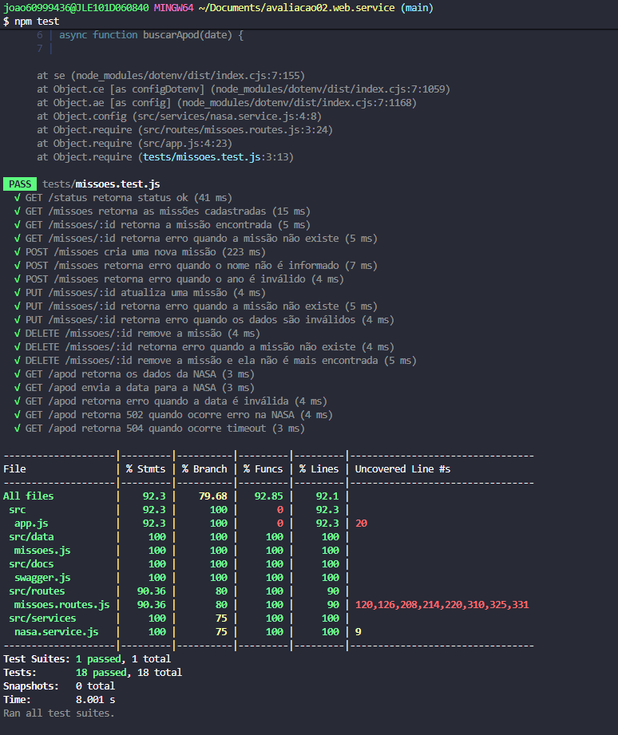
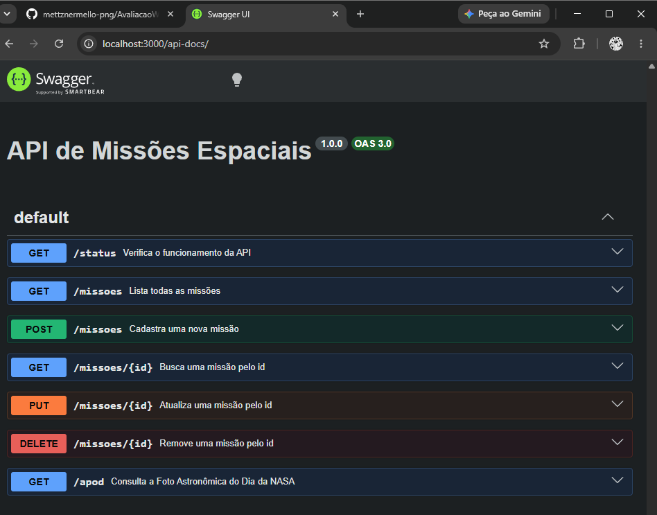

# avaliacao02.web.service

## 1. Identificação:
João Victor Costa Souza
2608 - Informática para Internet
Unidade Curricular: Desenvolver Serviços Web

## 2. Descrição do Projeto:
API para cadastrar, consultar, atualizar e remover missões espaciais, com consulta à foto astronômica do dia da NASA (APOD), testes automatizados e documentação Swagger.

## 3. Tecnologias Utilizadas:
Node.js
Express
Jest
Supertest
Swagger
Axios
dotenv

## 4. Clonar Repositório:
git@github.com:joaosxfz/avaliacao02.web.service.git

## 5. Como Instalar as Dependências
npm install

## 6. Como Executar o Projeto
npm start
API: http://localhost:3000
Swagger: http://localhost:3000/api-docs

Antes de executar, copie o `.env.example` para `.env` e informe sua `NASA_API_KEY` (chave gratuita em https://api.nasa.gov):

```bash
cp .env.example .env
```

Conteúdo do `.env`:

```dotenv
NASA_API_KEY=sua_chave_aqui
```

Sem a chave, a API usa `DEMO_KEY`, com limite de uso reduzido.

Para iniciar:
Copie o `.env.example` para `.env` e informe sua `NASA_API_KEY` (chave gratuita em api.nasa.gov). Sem a chave, a API usa `DEMO_KEY`, com limite de uso reduzido.

## 7. Como Executar os Testes
npm test
os testes cobrem todas as rotas (status, CRUD de missões e /apod), casos de sucesso e de erro, e o /apod usa axios simulado com jest.mock, sem chamar a NASA de verdade.

## 8. Documentação dos Endpoints

### GET /status
- **Objetivo:** verificar se a API está funcionando
- **Exemplo de requisição:** `GET http://localhost:3000/status`
- **Exemplo de resposta:**
```bash
{
  "status": "ok"
}
```
- **Status possíveis:** 200

### GET /missoes
- **Objetivo:** listar todas as missões
- **Exemplo de requisição:** `GET http://localhost:3000/missoes`
- **Exemplo de resposta:**
```bash
[
  {
    "id": 1,
    "nome": "Apollo 11",
    "ano": 1969,
    "agencia": "NASA",
    "status": "Concluída"
  }
]
```
- **Status possíveis:** 200

### GET /missoes/{id}
- **Objetivo:** buscar uma missão pelo id
- **Exemplo de requisição:** `GET http://localhost:3000/missoes/1`
- **Exemplo de resposta:**
```bash
{
  "id": 1,
  "nome": "Apollo 11",
  "ano": 1969,
  "agencia": "NASA",
  "status": "Concluída"
}
```
- **Status possíveis:** 200, 404

### POST /missoes
- **Objetivo:** cadastrar uma nova missão
- **Exemplo de requisição:** `POST http://localhost:3000/missoes`
```bash
{
  "nome": "Artemis III",
  "ano": 2027,
  "agencia": "NASA",
  "status": "Planejada"
}
```
- **Exemplo de resposta:**
```bash
{
  "id": 6,
  "nome": "Artemis III",
  "ano": 2027,
  "agencia": "NASA",
  "status": "Planejada"
}
```
- **Status possíveis:** 201, 400

### PUT /missoes/{id}
- **Objetivo:** atualizar uma missão existente
- **Exemplo de requisição:** `PUT http://localhost:3000/missoes/1`
```bash
{
  "nome": "Apollo 11 Atualizada",
  "ano": 1969,
  "agencia": "NASA",
  "status": "Concluída"
}
```
- **Exemplo de resposta:**
```bash
{
  "id": 1,
  "nome": "Apollo 11 Atualizada",
  "ano": 1969,
  "agencia": "NASA",
  "status": "Concluída"
}
```
- **Status possíveis:** 200, 400, 404

### DELETE /missoes/{id}
- **Objetivo:** remover uma missão
- **Exemplo de requisição:** `DELETE http://localhost:3000/missoes/5`
- **Exemplo de resposta:** sem corpo (204 No Content)
- **Status possíveis:** 204, 404

### GET /apod
- **Objetivo:** consultar a foto astronômica do dia da NASA. O parâmetro `date` (YYYY-MM-DD) é opcional; sem ele, retorna o APOD do dia.
- **Exemplo de requisição:** `GET http://localhost:3000/apod?date=2024-01-15`
- **Exemplo de resposta:**
```bash
{
  "date": "2024-01-15",
  "title": "Título da imagem",
  "explanation": "Texto explicativo sobre a imagem do dia.",
  "media_type": "image",
  "url": "https://apod.nasa.gov/apod/image/exemplo.jpg",
  "hdurl": "https://apod.nasa.gov/apod/image/exemplo_hd.jpg",
  "copyright": "Nome do autor"
}
```
- **Status possíveis:** 200, 400, 429, 502, 504

## 9. Evidências
npm test:


Swagger UI:
